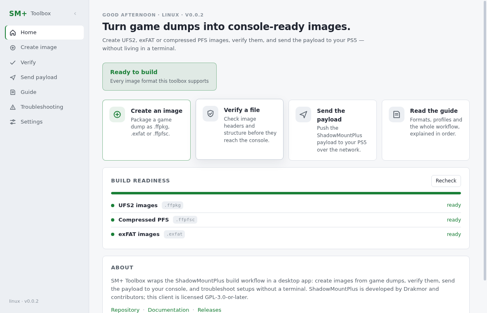
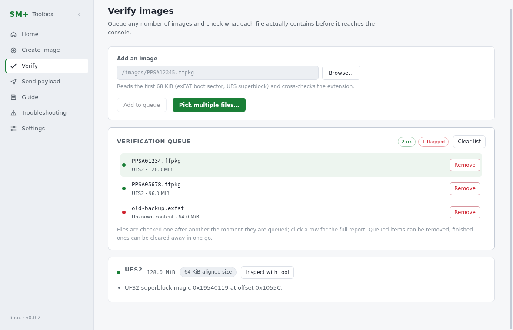
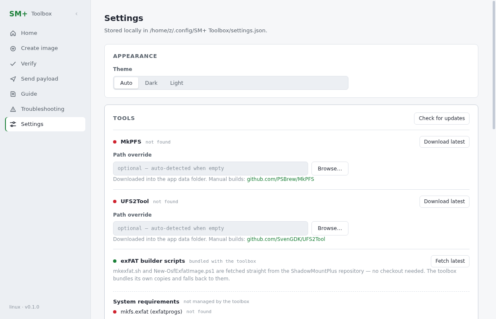
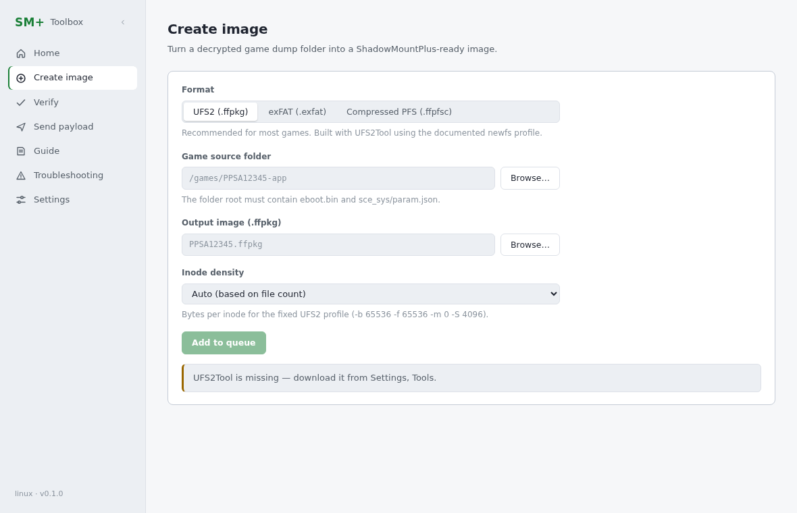
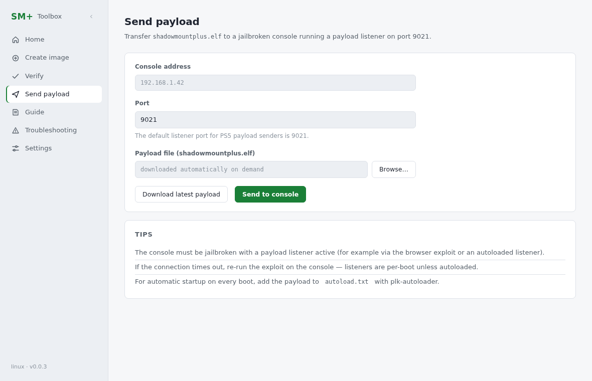

# SM+ Toolbox

[](https://github.com/AldySan/SM-Toolbox/actions/workflows/build.yml)
[](LICENSE)
[](#installation)

SM+ Toolbox is a desktop companion for [ShadowMountPlus](https://github.com/drakmor/ShadowMountPlus), a PS5 homebrew project that lets you mount game images from external storage.

Building those images usually involves running commands in a terminal, handling elevated permissions, and occasionally reaching for a hex editor when something doesn't look right. SM+ Toolbox brings that workflow into a single desktop app, with support for both Windows and Linux.



## Features

### Build and manage images

SM+ Toolbox supports all three image formats used by ShadowMountPlus:

- **UFS2 (`.ffpkg`)** — build UFS2 filesystem images from decrypted game dumps.
- **exFAT (`.exfat`)** — create exFAT images using the documented filesystem profile.
- **Compressed PFS (`.ffpfsc`)** — package game files into compressed PFS containers using MkPFS.

Need to prepare more than one image? Add them to the build queue and let the app process them in order. Each build starts automatically when the previous one finishes. After a successful build, the app can also verify the finished image and clean up the source folder for you — both options only run once every build step has succeeded.

You can also override what the image shows on the PS5 home screen: set a custom **title** and pick a custom **icon** on the Create view, and the app writes them into `sce_sys/param.json` (`titleName`) and `sce_sys/icon0.png` (512×512 PNG) inside the built image. Icons are decoded, center-cropped and resized automatically, and the overrides are applied to a staged hardlink copy — the source folder itself is never modified.

### Verify images before using them

Queue any number of images and check what each file actually contains: filesystem signatures, file extension, cluster size, and 64 KiB alignment are inspected as soon as a file is queued, with a clear verdict per image. Anything suspicious can be inspected further using UFS2Tool and MkPFS, so problems surface before the files ever reach your console.



### Send payloads to your console

Download `shadowmountplus.elf` from within the app and send it to a payload listener on your console over TCP port `9021`. The downloaded file is cached locally for subsequent use.

### Keep the tools up to date

On startup, the app can check GitHub for a newer SM+ Toolbox release and direct you to it. Automatic update checks can be disabled in Settings, and you can always check manually.

The built-in tool manager also handles downloading UFS2Tool and MkPFS, so you don't have to hunt down those dependencies yourself.

When something is missing, the Home view offers a one-click setup that installs everything the app can manage in a single pass, and Settings can check those tools for newer releases.



### Built-in documentation

Installation instructions, usage notes, and troubleshooting information from the ShadowMountPlus README are available inside the app, with search to help you find what you need.

One thing worth noting: **commands aren't hidden behind the UI.** Before execution, the app previews the commands it will run, and the terminal panel shows the tools, arguments, and output as each step progresses.



## Requirements

The requirements depend on which image format you want to build.

| Requirement | Windows | Linux |
|---|---|---|
| UFS2 images and verification | UFS2Tool (managed by the app) | UFS2Tool (managed by the app) |
| Compressed PFS images | Python 3 for running the MkPFS wheel | Python 3 for running the MkPFS wheel |
| exFAT images | [OSFMount](https://www.osforensics.com/tools/mount-disk-images.html) and administrator privileges (UAC) | `exfatprogs`, `exfat-fuse`, `fuse3`, `rsync`, and `pkexec`/polkit |
| Payload sending | No additional platform-specific dependency | No additional platform-specific dependency |

Regardless of your platform, you'll also need:

- A decrypted game dump with `eboot.bin` and `sce_sys/param.json` in the root directory.

The exFAT builder scripts (`mkexfat.sh` / `New-OsfExfatImage.ps1`) ship inside the app, and Settings → Tools can fetch the latest copies straight from the [ShadowMountPlus](https://github.com/drakmor/ShadowMountPlus) repository — no checkout or clone is ever needed.

The app checks for the required game files before starting a build, so an incomplete source directory won't be processed.

UFS2Tool and MkPFS are downloaded from their respective upstream releases:

- [SvenGDK/UFS2Tool](https://github.com/SvenGDK/UFS2Tool)
- [PSBrew/MkPFS](https://github.com/PSBrew/MkPFS)

No account or credentials are required to download these tools.

## Installation

Head over to the [Releases page](https://github.com/AldySan/SM-Toolbox/releases) and download the package for your platform.

**Windows**
- `SM-Toolbox-Setup.exe` — install the application normally.
- Portable `.zip` — extract the archive and run `sm-toolbox.exe`.

**Linux**
- `.AppImage`
- `.deb`
- `.rpm`

If you'd rather build the application yourself, follow the instructions below.

## Building from source

You'll need Node.js 22 or newer.

```sh
git clone https://github.com/AldySan/SM-Toolbox.git
cd SM-Toolbox
npm install

# Start the app in development mode
npm start

# Run unit tests
npm test

# Check TypeScript types
npm run typecheck

# Package the app
npx electron-forge package

# Build distributable packages
npx electron-forge make
```

Packaged output is written to `out/`.

A few size optimizations are applied to the distributables: Chromium locale packs other than `en-US` are pruned from every package, and AppImages use zstd-compressed SquashFS with 1 MiB blocks (`forge/mksquashfs` rewrites the maker's block-size arguments), which makes the AppImage roughly 17% smaller than the gzip default while staying compatible with `--appimage-extract-and-run` on systems without FUSE. Building the AppImage requires `mksquashfs` from `squashfs-tools` on your `PATH`.

There's also a headless smoke test for checking that the packaged app can start, open its window, and exit cleanly:

```sh
./out/<platform>/sm-toolbox --smoke-test
```

This is the same basic check used by CI on every commit.

`npm install` may print three deprecation warnings — `glob@7`, `inflight@1`, `rimraf@2` — pulled in transitively by Electron's own packaging tools (`electron-winstaller`, `electron-installer-common`, both already at their latest versions). They are build-time-only dependencies, nothing deprecated ships inside the app, and the newer majors of those packages drop callback-style APIs those tools still require, so overriding them would break the Windows installer and the deb/rpm makers. Every Electron Forge project that ships those installers sees the same lines.

## How it's built

SM+ Toolbox uses Electron, with a separate main process and renderer process. The main process handles filesystem access, external tools, build execution, and other privileged operations. The renderer is a React application that communicates with it through a limited preload API.

The application runs with `contextIsolation` enabled, `nodeIntegration` disabled, and ASAR integrity checks enforced.

Here's the rough layout of the source tree:

```text
src/
├── main/                   # Privileged process
│   ├── ipc.ts              # IPC handlers for app features
│   └── lib/
│       ├── recipes.ts      # Image build steps for each format
│       ├── runner.ts       # Step execution, output, cancellation, elevation
│       ├── queue.ts        # Build queue state machine
│       ├── env.ts          # Toolchain detection and resolution
│       ├── verifier.ts     # Folder stats and image signature detection
│       ├── toolmanager.ts  # UFS2Tool and MkPFS downloads
│       ├── payload.ts      # Payload download and TCP transfer
│       ├── setup.ts        # One-click setup planning
│       ├── updater.ts      # GitHub release checks
│       ├── version.ts      # Semantic version comparison
│       └── settings.ts     # Persistent app settings
├── preload/                # Restricted API exposed to the renderer
├── renderer/               # React UI, queue panel, terminal dock
└── shared/                 # Shared types and IPC channel names
```

The image builders follow the procedures documented by ShadowMountPlus rather than introducing their own filesystem layouts. For example, the UFS2 builder uses the documented `newfs` profile (`-O 2 -b 65536 -f 65536 -m 0 -S 4096`) with tiered inode density, while the exFAT builder uses a fixed 64 KiB cluster size. Compressed PFS images are created in two steps: `mkpfs pack folder`, followed by `pack file`.

The build recipes are pure functions with unit tests. A separate runner takes care of executing each step, streaming its output, handling cancellation, and requesting elevated privileges when necessary.

Privilege handling is platform-specific:

- **Linux:** privileged steps use `pkexec`/polkit when available. Otherwise, the app prints the corresponding `sudo` command so you can run it yourself.
- **Windows:** the exFAT builder requests elevation through UAC, with its output streamed back into the terminal panel.

## Verification and safety



A few checks are built into the workflow to catch common mistakes before they become harder to diagnose:

- **Filesystem detection:** reads the first 68 KiB of an image and checks its filesystem signatures. For example, a file named `.ffpkg` that actually contains an exFAT filesystem can be flagged.
- **exFAT profile validation:** checks for the expected 64 KiB cluster size and a total image size aligned to 64 KiB.
- **Payload integrity:** downloads are written to a temporary `.part` file before being renamed into place. The ELF magic is checked before the payload can be sent.
- **Tool path validation:** custom tool paths configured in Settings are checked before use, so invalid paths produce a clearer error instead of an opaque process-spawning failure.

These checks don't replace testing on your console, but they help catch several common configuration and file-format issues early.

## Development

A few conventions used in this repository:

- **Commit messages:** follow Conventional Commits.
- **Pull requests:** target `dev`; `main` tracks releases.
- **CI:** `.github/workflows/build.yml` builds and smoke-tests the app on `ubuntu-latest` and `windows-latest` for pushes and pull requests. Tagged releases matching `v*` also receive Windows and Linux distributables.
- **Tests:** run with Vitest via `npm test`. The suite covers build recipes, image detection, the build and verification queue state machines, semantic-version comparison, and the one-click setup planner. These tests don't require network access or an Electron runtime.

## Contributing

Bug reports, suggestions, and pull requests are welcome.

If you're adding support for another tool, follow the existing `ToolInvocation` pattern (`command`, `prefix`, `env`, and `origin`). This keeps new integrations compatible with tool overrides, PATH detection, and the built-in tool manager.

For larger changes, opening an issue first is a good way to discuss the approach before putting in the work.

## License

SM+ Toolbox is licensed under [GPL-3.0-or-later](LICENSE), the same license used by ShadowMountPlus.

This is an independent companion project and is not affiliated with Sony. It builds on the work of the [ShadowMountPlus](https://github.com/drakmor/ShadowMountPlus) contributors, [SvenGDK's UFS2Tool](https://github.com/SvenGDK/UFS2Tool), and [PSBrew's MkPFS](https://github.com/PSBrew/MkPFS).
